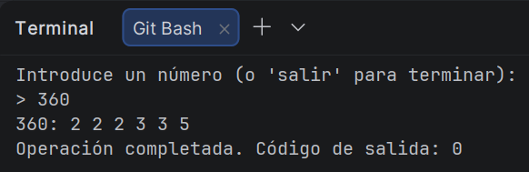
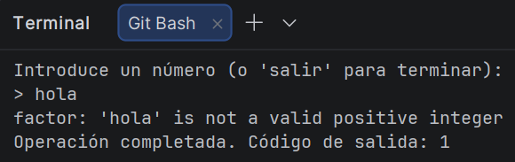

# Tarea 05 · Auditoría Cósmica: El Detector de Primos

Módulo PSP · CFGS DAM 2 · Curso 2026-2027

## Niveles hechos

- [x] Nivel 1 (obligatorio)
- [x] Nivel 2 · salida etiquetada con `[OK]` / `[ERROR]`
- [x] Nivel 3 · redirección a `factor_output.log` y `factor_error.log`
- [x] Nivel 4 · indica si el número es primo

## Cómo se ejecuta

Necesita el comando `factor` (viene con Linux).

```bash
cd src
javac Lanzador.java Interfaz.java
java Interfaz
```

Primero pregunta el nivel (1, 2, 3 o 4) y después pide números hasta escribir `salir`.

## Clases

- `Interfaz`: pide el nivel y los números en bucle. Se los pasa a `Lanzador`.
- `Lanzador`: crea el proceso `factor <número>` con `ProcessBuilder`, lo
  ejecuta y devuelve el código de salida. Tiene un método por nivel.

---

## Tabla de pruebas (nivel 1)

| Valor | Salida de factor                              | Código de salida |
|-------|-----------------------------------------------|------------------|
| 360   | `360: 2 2 2 3 3 5`                            | 0 |
| 1     | `1:` (no hay factores)                        | 0 |
| 17    | `17: 17`                                      | 0 |
| hola  | `factor: 'hola' is not a valid positive integer` | 1 |
| -5    | `factor: invalid option -- '5'` y `Try 'factor --help' for more information.` | 1 |

Cosas que se ven en la tabla:

- `1` no da error: `factor` responde `1:` porque no tiene factores primos.
- `-5` no se interpreta como número negativo: `factor` cree que `-5` es una
  opción de la línea de comandos (como `-h`), y por eso la rechaza.

## Un error que tuve programando

- Al ejecutar el programa desde Windows me salió el error `No se pudo ejecutar factor: Cannot run program "factor": CreateProcess error=2, El sistema no puede encontrar el archivo especificado`, al ser `factor` un comando de Linux. Lo ejecuté desde Git Bash (que trae el comando integrado) y funcionó.


---

## Capturas

### Número correcto



### Número incorrecto



### Nivel 3: contenido de los ficheros `.log`

Después de probar `360`, `17` y `hola` en el nivel 3:

`factor_output.log`
```
360: 2 2 2 3 3 5
17: 17
```

`factor_error.log`
```
factor: 'hola' is not a valid positive integer
```

Si se ejecuta otra vez, se añaden líneas nuevas al final (`appendTo`) y no se
borra lo anterior.

---

## Declaración de uso de IA

    - Usé Claude y Gemini como guía